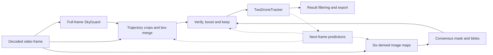

# Drone detection and tracking

Finds and tracks up to 2 drones in 1920x1080 video and writes one result file per video:
`frame,id,left,top,width,height,confidence` (frames start at 1, IDs are 1 or 2 and can be recovered when a drone leaves and returns).
Target: real time (50 fps or more) on a Raspberry Pi with the AI HAT+ (Hailo-8, 26 TOPS).

## How it works

The recommended two-model pipeline detects drones across the whole frame, checks
selected crops around predicted tracks, and uses temporal image evidence to refine
the candidates before tracking. The tracker feeds its next-frame predictions back
to the crop and image-layer stages.

- [Frame flow and models](#frame-flow-and-models)
- [Six image layers](#six-image-layers)
- [Consensus and score refinement](#consensus-and-score-refinement)
- [Tracking and result files](#tracking-and-result-files)
- [Entry points and demo views](#entry-points-and-demo-views)

### Frame flow and models



1. **Whole-frame detection.** The recommended run uses the original SkyGuard
   checkpoint at `imgsz=1280` with a confidence floor of `0.01`.
   [`run_video.py`](run_video.py) can cache these candidates by frame, so different
   tracking runs can reuse the same detector output. It defaults to `imgsz=640`
   on its own. Use `--imgsz 1280 --keep drone` for the documented cache.
2. **Trajectory crops.** For each active track, the pipeline checks whether a
   candidate already overlaps its predicted box at IoU greater than `0.20`
   with a score at least as high as the tracker's low threshold (`0.05`).
   Otherwise it takes a 320 px crop centered near the prediction and fits it
   inside the source frame. The boosted preset enlarges it 2× with cubic
   interpolation and runs the fine-tuned checkpoint at `imgsz=640` with a
   `0.05` score floor. It divides the crop coordinates by two and adds the crop
   origin to map boxes back to source pixels. A crop box that overlaps an
   existing candidate at IoU greater than `0.30` replaces it if it scores higher.
   A box without such an overlap is appended.
3. **Temporal refinement.** The six derived maps are computed at a smaller
   working resolution. The consensus mask and selected blobs help the
   verifier, booster and keeper decide which candidates to pass to the tracker.
4. **Tracking.** The tracker advances in frame order. It associates candidates
   with active tracks, confirms new tracks and produces boxes with IDs and
   confidence. Each video starts with fresh tracker, layer and consensus state.

| Checkpoint | Role | Expected path |
|---|---|---|
| SkyGuard YOLO11n | Whole-frame detection. The basic pipeline also reuses it for crops. | `../pretrained/drone-detection-yolov11/best.pt` |
| Fine-tuned crop checkpoint | Second-pass detection on enlarged trajectory crops. The v0.883 release asset is `ft_1280_ep1_crop.pt`. | `runs/ft_1280/weights/epoch0.pt` |

Both supplied checkpoints take ordinary color images and predict the `drone`
class. The six derived maps are computed alongside inference and used after
it. [SkyGuard model card](https://huggingface.co/SkyGuardAI/drone-detection-yolov11)
· [v0.883 release](https://github.com/czarekkdev/drone_detection/releases/tag/v0.883)

<details>
<summary>YOLO11n module map for both checkpoints</summary>

The module numbers below come from the two supplied PyTorch checkpoints.
The backbone extracts features, the neck combines features from different
scales, and the head predicts boxes and class scores.

| Modules | Blocks | Role |
|---|---|---|
| 0–2 | `Conv`, `Conv`, `C3k2` | Early downsampling and feature extraction. |
| 3–4 | `Conv`, `C3k2` | Backbone features at stride 8. |
| 5–6 | `Conv`, `C3k2` | Backbone features at stride 16. |
| 7–8 | `Conv`, `C3k2` | Backbone features at stride 32. |
| 9–10 | `SPPF`, `C2PSA` | Pooling expands the spatial context, then attention refines the deepest features. |
| 11–13 | `Upsample`, `Concat`, `C3k2` | Upsamples and fuses with backbone layer 6 at stride 16. |
| 14–16 | `Upsample`, `Concat`, `C3k2` | Upsamples and fuses with backbone layer 4 at stride 8. |
| 17–19 | `Conv`, `Concat`, `C3k2` | Downsamples and fuses with neck layer 13 at stride 16. |
| 20–22 | `Conv`, `Concat`, `C3k2` | Downsamples and fuses with layer 10 at stride 32. |
| 23 | `Detect` | Predicts box coordinates and drone scores using layers 16, 19 and 22 at strides 8, 16 and 32. |

</details>

Models and crop coordinates use source-image pixels once their predictions are
mapped back. The offline tracking scripts use a 1920 × 1080 tracker canvas.
The demos and `pi_run.py` pass the decoded dimensions to the tracker.

### Six image layers

[`LayerMaker`](layers.py) scales each frame to a fixed width while preserving
its aspect ratio. The standalone default is 960 px. The recommended boosted
preset uses 480 px, which gives a 480 × 270 layer grid for 1920 × 1080 input.
Each layer is an unsigned 8-bit image on that grid.

**Shared camera alignment.** The frame is converted to grayscale and lightly
blurred. To align successive frames, the code tracks corners with pyramidal
Lucas–Kanade optical flow, fits a RANSAC homography and applies sanity checks
to its scale, perspective and shift. If feature alignment fails, phase
correlation estimates a translation. Weak responses or shifts above 40
working pixels fall back to zero translation. Adjacent transforms are composed
to align older frames with the current one. Pixels outside the valid warped
area contribute zero to the short and long differences. Difference maps
use a noise estimate of `1.4826 × median difference + 1`. The layer divides
the difference by that estimate, scales it by `gain / 4` (default gain 32) and
clips it to the 8-bit range.

| Layer | How it is computed | Role in the boosted pipeline |
|---|---|---|
| `short` | Takes the smaller of the two absolute grayscale differences against the aligned frames at `t−1` and `t−2`. It starts at zero until both frames are available. | Together with `long`, contributes one motion vote. The minimum reduces changes that appear in only one comparison. |
| `long` | Takes the absolute difference against the aligned frame at `t−10` by default. It stays at zero during the initial history window. | Makes slower changes visible and shares the motion vote with `short`. |
| `bg` | Warps the running background into the current frame, initializes newly exposed pixels from the current image, then blends 95% previous background with 5% current grayscale. The layer is the difference from the updated background and starts at zero. | Contributes a background vote for pixels that depart from the running scene model. |
| `track` | Draws a Gaussian spot around each predicted active-track center. Its horizontal and vertical spreads are 0.6× the predicted box dimensions, with a 4-pixel minimum in working coordinates. Overlapping spots combine by maximum. | Marks areas where consensus can accept weaker evidence. With no predictions it is zero. |
| `prev` | Shows the aligned previous grayscale frame once two earlier frames are available. During startup it shows the current grayscale image. | Used in the layer viewer and available in the packed layer tensor. Consensus leaves it out of voting. |
| `shape` | Measures absolute contrast from the local mean in a 121 × 121 window. It divides by the local standard deviation plus 4, multiplies by 48, then clips to the 8-bit range. | Contributes a contrast vote. A bright or dark silhouette can register even when it barely moves, while textured regions get a higher divisor. |

`layers.stack()` stacks the maps in the order `short, long, bg, track, prev, shape`
into an `H × W × 6` array. This tensor is available for experimentation.
[`mlayer.py`](mlayer.py) implements a separate
[`train.py --variant ml`](train.py) experiment. Its first convolution receives
five channels made from the same frame, `R, G, B, grayscale, inverted grayscale`.
The extra channels start with zero convolution weights so the replacement stem
starts with the RGB model's output.

**Separate motion detector.** [`MotionDetector`](motion_live.py) supports the
basic demo's difference image, motion mask and optional motion-seeded crops.
It aligns the past two frames, takes the minimum of their absolute differences,
thresholds at four times its noise estimate, then opens and dilates the mask
before extracting connected components. It reports full-frame motion blobs with
a strength and a persistence count over the previous two frames. The basic
pipeline can send strong, uncovered spots to the crop detector.
[`motion_verify.py`](motion_verify.py) is an offline variant that reads cached
motion blobs and runs the detector on up to eight uncovered crops per frame by
default. The recommended boosted preset keeps these standalone motion-seeded
crops off and still uses temporal motion in consensus.

### Consensus and score refinement

[`Consensus`](consensus.py) gives each pixel up to three votes using the
default thresholds below.

| Vote | Condition |
|---|---|
| Motion | `max(short, long) > 128` |
| Background difference | `bg > 128` |
| Local contrast | `shape > 150` |

Two votes are enough across the frame. Where `track > 40`, one vote is enough.
A 3 × 3 morphological close joins small gaps in the binary mask. The code
then extracts 8-connected components. It keeps areas from 3 pixels to 0.4%
of the layer grid and an aspect ratio up to 6. It ranks the components by
layer evidence with a bonus near a predicted track. A component must be near
an eligible component from the previous frame or reach an evidence score of
1.0. The persistence radius scales with layer width and is 30 px at 480 px. The five highest-ranked survivors are returned as
full-frame blobs. The binary mask remains available before blob filtering.

The recommended preset applies these operations in order after crop merging.

| Operation | Input and decision | Effect |
|---|---|---|
| Verifier | Checks the binary mask around each candidate below `0.50`, after mapping its box to the layer grid and expanding it by two working pixels on each side. | Multiplies the score by `0.30` when the box has no mask support. |
| Agreement boost | Compares candidates scoring at least `0.10` and below `0.30` with the filtered blobs. Their centers must line up by the containment test and the blob's largest dimension must be 0.5–2× the box's. | Raises a qualifying score to `0.65` before tracking. |
| Motion-aware keeper | Looks for a nearby, similarly sized filtered blob when an active track has no supporting candidate. The blob must agree with that track's motion from the previous frame. | Supplies a temporary box at confidence `0.25` to continue an existing track for up to five frames. |

For moving tracks, keeper motion must be within 45° of the predicted direction
and 0.5–1.5× the predicted speed. For an almost stationary track, the keeper
requires the blob to be almost stationary as well. A valid detector candidate
resets the keeper streak. If blob support fails during a gap, the keeper waits
for detector support before continuing again. The verifier uses the mask,
while the boost and keeper use the filtered blob list. The keeper can bridge
an existing track gap. New tracks come from detector candidates, including
candidates whose scores were boosted.

[`boost.py`](boost.py) implements this sequence for `pi_run.py`.
[`pipeline_boost.py`](pipeline_boost.py) exposes the component flags for scoring.
The documented run uses
`--no-motion --layer-width 480 --verify --keeper2 --agree-boost 0.1 --boost-to 0.65 --crop-scale 2`.
Calling the offline script with its bare defaults leaves verification, score
boosting and the keeper off and uses 1× crops with 960 px layers. The offline
script also offers `--blobs consensus` or `--blobs motion` for extra crop
proposals, `--keeper` for a position-only keeper, and `--agree-filter` to drop
boxes below `0.60` without a matching consensus blob.

### Tracking and result files

[`TwoDroneTracker`](tracker.py) uses a constant-velocity Kalman filter. Its
state contains the box center and size `(cx, cy, w, h)` plus their four
per-frame velocities. It predicts boxes before assignment and updates the
state using candidate measurements. The tracker assigns boxes with the
Hungarian algorithm using center distance normalized by box size plus a
penalty for a box-area change. Missing tracks get a wider position gate.

1. **Associate active tracks.** Match scores at or above `0.60` first, then
   let unmatched active tracks use candidates from `0.05` up to `0.60`.
2. **Recover a recent ID.** A remaining candidate at or above `0.20` can
   recover an ID lost within 30 frames of its last observation if its position
   and box area pass the re-acquisition gates.
3. **Confirm a tentative track.** New tracks use unmatched high-score
   detections and require three matching hits. Although the separate
   `new` threshold defaults to `0.30`, the high-score pool sets the effective
   default entry floor of `0.60`. Confirmation can backfill the tentative
   observations into the result file.
4. **Coast and reassign.** A confirmed track can emit its predicted box for up
   to three consecutive misses, decaying confidence by `0.6 ** misses`.
   After that, its state moves into the lost list. If both IDs are free,
   stored position and aspect help choose an ID. The tracker-only replay can
   also use hue/saturation and brightness histograms when `--videos` is
   supplied. Those histograms affect lost-ID assignment.
5. **Resolve duplicates.** A newly confirmed, nearby, similarly sized track can
   inherit the ID of a coasting track. Containment checks suppress duplicate
   starts and merge conflicting active tracks. The current-frame output keeps
   the stronger box when two boxes are mostly contained or their centers are
   closer than half the larger box's longest side.

**Screen and file output.** The tracker clips boxes to the frame, rejects
boxes with a side below 2 px or less than a quarter of their original area
visible, and applies the default `0.05` output floor. The boosted demo
applies a separate display rule. It waits for 12 current-frame observations
and a median confidence of at least `0.50` over the first 60 observations
available. A new appearance needs `--show-min` (default `0.30`) to be drawn.
Once visible, it can stay on screen down to `0.05`.

At export, `dedupe_lines()` keeps the highest-confidence box per frame and ID.
It groups each ID's emitted observations into appearances across frame-number
gaps of at most five, drops appearances spanning fewer than 12 frames, and
drops appearances whose first up to 60 emitted scores have a median below
`0.50`. These filters operate on frame counts and the complete result file.

Each result file contains one comma-separated row per emitted box.

```text
frame,id,left,top,width,height,confidence
```

Frames are one-based. Coordinates are in source-image pixels. Detector caches
use the same columns with a placeholder ID of `1`. Ground truth goes in
`<clip>/gt/gt.txt` with the first six columns. The evaluator expects a result
file named `<clip>.txt` for each clip.
[`eval_track.py`](eval_track.py) matches boxes at IoU ≥ 0.50 for MOTA, IDF1,
precision, recall and ID switches. It reports mean per-clip AP50 as a separate
box metric. Its `--min-conf` applies to MOT metrics. [`score.py`](score.py)
also reports detector-only AP50, AP30 and the best-F1 confidence.

### Entry points and demo views

| Entry point | Processing path |
|---|---|
| [`run_video.py`](run_video.py) | Whole-frame detector and candidate cache. |
| [`run_tracker.py`](run_tracker.py) | Tracker-only replay from the cache, with optional video-derived appearance histograms. |
| [`pipeline.py`](pipeline.py) | Whole-frame inference or cached candidates, 1× trajectory crops, optional precomputed motion crops and tracking. |
| [`pipeline_boost.py`](pipeline_boost.py) | Configurable offline boosted path for scoring. Use the recommended flags above to enable the full two-model preset. |
| [`demo.py`](demo.py) | Interactive basic path using [`DroneStack`](stack.py). Uses one checkpoint for full frames and crops, with optional motion crops and layer views. |
| [`demo_boost.py`](demo_boost.py) | Interactive two-model boosted demo. `--one-model` also uses SkyGuard for crop inference. `--view overlay` starts with the consensus overlay. |
| [`pi_run.py`](pi_run.py) | Torch or Hailo inference with the shared boosted logic. `--simple` uses the whole-frame model for 1× crops and skips the consensus stage. |

| View | How to open it | What it shows |
|---|---|---|
| Camera | `1` in both demos | Source video with current track boxes, IDs and optional trails. |
| Motion difference, mask and four-panel view | `2`, `3`, `4` in the basic demo | Legacy motion response, its binary mask, or camera, response, mask and background together. |
| Individual layer views | `5`, `6`, `7`, `8`, `b` in the basic demo | Short, long, background, track prior and local contrast. |
| Full layer grid | `0` in both demos | The boosted demo shows the camera, all six image layers, consensus blobs and motion blobs at once. The basic demo shows its camera and colorized layer panels. |
| Individual layer cycle | `g` in the boosted demo | Cycles through short, long, background, track, previous grayscale, shape, consensus and motion blobs one view at a time. |
| Consensus | `c` in the boosted demo | The white consensus mask with filtered blobs outlined in green. |
| Motion blobs | `m` in the boosted demo | Motion-only mask with compact components outlined in green; these blobs do not require shape/background agreement. |
| Camera + consensus | `o` or `--view overlay` in the boosted demo | The consensus mask tinted red over the original video. |

In the basic demo, `m` switches motion crops and `p` switches trajectory crops.
In the boosted demo, `b` switches the score boost, `k` switches the keeper, and `f` toggles the optional camera-motion-subtracted optical-flow diagnostic (extra CPU work while enabled). `o` overlays the consensus mask on the camera view.
Both demos use `t` to switch trails. The boosted view outlines crop regions in
green, boosted candidates in yellow and keeper boxes with a dashed outline.

**Runtime backends.** `pi_run.py` overlaps frame capture, whole-frame inference,
and the ordered finish stage with three threads and bounded queues. The finish
stage runs crops, consensus and association in order so each frame receives
the latest tracker state. Torch selects MPS, CUDA or CPU. Hailo uses compiled
`.hef` models with on-device non-maximum suppression. Its adapter letterboxes
BGR frames into RGB and maps normalized boxes back to source coordinates. The
compiled models fix the input resolution. Image layers and tracking run on
the CPU in both backends. `--cmc` additionally applies the layer alignment
transform to tracker positions and velocities and is off by default.

## Scores on the 3 practice videos (IoU 0.5)

| Setup | MOTA | IDF1 | Precision | Recall | ID switches |
|---|---|---|---|---|---|
| SkyGuard + tracker | 0.843 | 0.916 | 0.983 | 0.858 | 0 |
| + trajectory crops | 0.855 | 0.916 | 0.980 | 0.873 | 1 |
| + boxes clipped to the frame (default, team evaluate.py) | 0.862 | 0.920 | 0.987 | 0.873 | 1 |
| + fine-tuned 1280 model on the trajectory crops only | 0.871 | 0.932 | 0.990 | 0.880 | 0 |
| + combined shape booster + keeper + verifier (`pipeline_boost.py`) | 0.878 | 0.936 | 0.991 | 0.886 | 0 |
| + quick re-acquisition after a sudden stop (tracker.py) | 0.880 | 0.937 | 0.986 | 0.893 | 0 |
| + trajectory crops enlarged 2x (`--crop-scale 2`) | 0.883 | 0.939 | 0.988 | 0.894 | 0 |
| + ID fixes (handover, inside, merge): same here, Anti-UAV ID switches 63 -> 35 | 0.883 | 0.939 | 0.988 | 0.894 | 0 |
| **+ boxes below 0.05 not output (tracker.py `MIN_SHOW`, best)** | **0.885** | **0.939** | **0.991** | **0.893** | **0** |

Best setup per video (MOTA): easy 0.964, medium 0.974, hard 0.818. The variants were chosen on these same 3 videos, so the gain on new videos may be a bit smaller.
Tried and worse: slowing the Kalman prediction on misses or matching near the last-seen spot (0.865-0.875), stacking past frames / de-blurring the crops (0.870-0.878), inverted-colour frames (0.79-0.83), squeezing crops along the motion direction (0.879-0.882), merging two full-frame models' boxes (0.84-0.855), feeding masked / dimmed / black-background frames to the AI (0.51-0.72), extra crops on every blob (0.857), dropping boxes with no blob (0.860),
learned confidence from all layers (0.859), ignoring non-moving boxes (0.869-0.873), point-motion layer (0.882),
constant-acceleration Kalman / stronger position weight (no gain), camera-motion compensation (`--cmc`: fewer wrong boxes
but one re-entry got the wrong number), higher output thresholds (0.1+: worse).

## Setup

    python -m venv .venv && source .venv/bin/activate
    pip install -r requirements.txt

Put the pretrained weights at `../pretrained/drone-detection-yolov11/best.pt` (download from the Hugging Face link above).
Data is not in this repo: `../test_sample_clean/<video>/video.mp4 (+ gt/gt.txt)`, `../hackathon_dataset`, Anti-UAV-RGBT.

### Run the PyTorch pipeline in Docker

Docker provides an isolated CPU-based PyTorch environment for running the video pipeline. Install Docker Desktop on Mac/Windows or Docker Engine with the Compose plugin on Linux, then start in the repository folder. The source tree, model folder and sample videos are mounted into the container; they are not copied into the image.

Build the image once:

    docker compose build

Run the boosted pipeline on the sample set:

    docker compose run --rm detector python pipeline_boost.py --videos /videos --out /output/boost --weights /models/drone-detection-yolov11/best.pt --no-motion --layer-width 480 --verify --keeper2 --agree-boost 0.1 --boost-to 0.65 --crop-scale 2

Results are written to `docker-output/boost` on your computer. To process a different folder, edit the `./test_sample_clean:/videos:ro` mount in `compose.yaml` to point to that folder, or change the mount target and `--videos` path together. For example, map `./my_videos:/videos:ro` and keep `--videos /videos`.

This container runs the PyTorch backend on CPU. It does not include Hailo's Dataflow Compiler or HailoRT and cannot create `.hef` files or access an AI HAT+ device. Use the Linux/WSL2 compiler instructions below to create HEFs, and the Pi setup for Hailo runtime.

## Run

Demo with switchable views:

    python demo.py ../test_sample_clean/test_6_hard_PXL_20261113_154422245_hard/video.mp4 --show
    python demo.py 0 --show            # live camera

Add `--clean` to hide the status text and answer boxes (nice for showing people).

Keys: 1 camera, 2 difference, 3 motion mask, 4 four-way view, 5 short diff, 6 long diff, 7 background diff,
8 tracker map, b brightness shape, 0 colorized layer grid (grayscale panels hidden), t trajectory, m motion crops, p trajectory crops,
o helper boxes, space pause, q quit.

Score all practice videos:

    python run_video.py --weights <best.pt> --videos ../test_sample_clean --out preds/x --imgsz 1280 --conf 0.01
    python pipeline.py --videos ../test_sample_clean --dets preds/x --out preds/x_trk --weights <best.pt> --no-motion
    python eval_track.py --gt ../test_sample_clean --pred preds/x_trk

Best setup (original SkyGuard on the full frame, fine-tuned 1280 model `ft_1280 epoch 1` on the crops; the fine-tuned weights are not in this repo):

    python run_video.py --weights ../pretrained/drone-detection-yolov11/best.pt --videos ../test_sample_clean --out preds/hf_skyguard --imgsz 1280 --conf 0.01 --keep drone
    python pipeline_boost.py --videos ../test_sample_clean --dets preds/hf_skyguard --out preds/boost --weights runs/ft_1280/weights/epoch0.pt \
      --no-motion --layer-width 480 --verify --keeper2 --agree-boost 0.1 --boost-to 0.65 --crop-scale 2
    python eval_track.py --gt ../test_sample_clean --pred preds/boost

Live demo of the best setup (keys: 1 camera, 0 full layer grid, g cycle individual layers, m motion blobs, c consensus, b booster, k keeper, t trails, space pause, q quit;
yellow box = booster confirmed a faint detection, dashed box = keeper held the track):

    python demo_boost.py                         # hard practice video
    python demo_boost.py --video path/to/any.mp4 # any video, --video 0 for the camera

`pi_run.py` is the real-time program for the Pi and runs the **full 0.883 setup** (same stages as `pipeline_boost.py`, shared in `boost.py`).
Check on the Mac (same code, PyTorch instead of Hailo): `python pi_run.py ../test_sample_clean --out results` and score `results/`.
With `--dets preds/hf_skyguard` it reuses the cached whole-frame detections and gives byte-identical files to `pipeline_boost.py`. `--simple` = old pipeline.

## Windows 10/11: complete guide

The detector, tracker, training scripts, evaluator, and live/video demos run natively in Windows PowerShell. Hailo `.hef` compilation is the exception; use WSL2 for that section below. These steps assume PowerShell, Python 3.11, and a project folder under your user directory.

### 1. Install Python and get the project

Install Python 3.11 from [python.org](https://www.python.org/downloads/) and select **Add Python to PATH** in the installer. Open a new PowerShell window and confirm `py -3.11 --version` prints Python 3.11. Then:

    $Root = "$env:USERPROFILE\drone detecting"
    New-Item -ItemType Directory -Force $Root | Out-Null
    Set-Location $Root
    git clone https://github.com/czarekkdev/drone_detection code
    Set-Location "$Root\code"

If Git is not installed, install Git for Windows first. Keep the repository in a normal Windows folder such as `C:\Users\<you>\drone detecting`; do not put the virtual environment inside OneDrive or a synced folder.

### 2. Create the environment and install packages

    py -3.11 -m venv .venv
    .\.venv\Scripts\Activate.ps1

If PowerShell blocks activation, run this once for your Windows account, close and reopen PowerShell, then activate again:

    Set-ExecutionPolicy -Scope CurrentUser RemoteSigned

For an NVIDIA graphics card, install the matching PyTorch CUDA build from [PyTorch's install selector](https://pytorch.org/get-started/locally/) first. For example, for CUDA 12.4:

    python -m pip install --upgrade pip
    pip install torch torchvision --index-url https://download.pytorch.org/whl/cu124
    pip install -r requirements.txt
    python -c "import torch; print('CUDA available:', torch.cuda.is_available())"

For CPU-only use, skip the CUDA install and install the project dependencies:

    python -m pip install --upgrade pip
    pip install -r requirements.txt
    python -c "import torch; print('CUDA available:', torch.cuda.is_available())"

`CUDA available: True` means PyTorch can use the NVIDIA GPU. If it prints `False`, the code still runs on the CPU, but video processing and the demo will be slower. AMD graphics cards are not supported by the CUDA setup.

### 3. Add the model weights and test videos

The Git repository does not include model weights or the practice videos. Arrange the folders like this (the video and ground-truth files are supplied separately):

    drone detecting\
      code\                         # cloned repository; run commands from here
        .venv\
        runs\ft_1280\weights\epoch0.pt   # fine-tuned crop model, if using best setup
      pretrained\drone-detection-yolov11\best.pt
      test_sample_clean\
        video_name\video.mp4
        video_name\gt\gt.txt

Create the parent folders as needed and copy the supplied files into these locations. If you have only the SkyGuard `best.pt` and no `epoch0.pt`, you can still run detection and the basic tracker; the full best setup below needs both weight files. Check that PowerShell can see the files before starting:

    Test-Path ..\pretrained\drone-detection-yolov11\best.pt
    Get-ChildItem ..\test_sample_clean -Recurse -Filter video.mp4
    Test-Path runs\ft_1280\weights\epoch0.pt

Each `Test-Path` needed for the command you plan to run should return `True`. Keep paths with spaces inside double quotes.

### 4. Run detection, tracking, and scoring

Run these from the repository folder with `.venv` active. Replace the video folder or weights path if yours differs. The angle brackets in documentation examples mean “replace this value”; do not type the brackets in PowerShell.

Run whole-frame detection first. This creates one detection file per input video under `preds\hf_skyguard`:

    python run_video.py --weights ..\pretrained\drone-detection-yolov11\best.pt --videos ..\test_sample_clean --out preds\hf_skyguard --imgsz 1280 --conf 0.01 --keep drone
    Get-ChildItem preds\hf_skyguard\*.txt

Then run the full shape-assisted tracker (requires the fine-tuned crop model), followed by the organizer's evaluator:

    python pipeline_boost.py --videos ..\test_sample_clean --dets preds\hf_skyguard --out preds\best --weights runs\ft_1280\weights\epoch0.pt --no-motion --layer-width 480 --verify --keeper2 --agree-boost 0.1 --boost-to 0.65 --crop-scale 2
    python evaluation.py --gt_dir ..\test_sample_clean --pred_dir preds\best

Copy the organizer-supplied `evaluation.py` into the repository folder before running the last command. It is separate from this repo. Check that `preds\hf_skyguard` and `preds\best` contain non-empty `.txt` files for the videos. If the evaluator reports missing files, first compare the video folder names under `test_sample_clean` with the prediction filenames; if it reports empty files, check that detection created boxes before running the tracker.

If you do not have the crop model or organizer evaluator, run the basic pipeline and included evaluator instead:

    python pipeline.py --videos ..\test_sample_clean --dets preds\hf_skyguard --out preds\basic --weights ..\pretrained\drone-detection-yolov11\best.pt --no-motion
    python eval_track.py --gt ..\test_sample_clean --pred preds\basic

You can also use the evaluator supplied by the team with `--pred_dir preds\basic` if its expected prediction format matches the generated files.

### 5. Play a video or use a camera

    python demo_boost.py --video "..\test_sample_clean\test_6_hard_PXL_20261113_154422245_hard\video.mp4"
    python demo_boost.py --video 0

The live camera is usually device `0`; try `1` if you have multiple cameras. Press `q` to quit. In `demo_boost.py`, press `f` to toggle the optional camera-motion-subtracted optical-flow view; it adds processing while enabled and does not change detections. Press `o` to toggle the combined-shape view.

### Common Windows issues

- **`python` is not recognized:** reinstall Python 3.11 with **Add Python to PATH**, or use `py -3.11` to create the environment. After activation, `python --version` should show 3.11.
- **Activation is disabled:** use the one-time `Set-ExecutionPolicy -Scope CurrentUser RemoteSigned` command above, or run commands with `.\.venv\Scripts\python.exe` without activating.
- **`FileNotFoundError`:** run `Get-Location` and `Test-Path <path>`; relative paths are resolved from the current folder. The commands in this guide expect the current folder to be `drone detecting\code`.
- **CUDA is unavailable:** verify the GPU is NVIDIA and reinstall the PyTorch build selected for your installed driver. CPU mode remains available.
- **OpenCV cannot open a video/camera:** try a different camera number, close other apps using the camera, and confirm the video plays in a media player.
- **Out of memory:** close GPU-heavy apps; for training, lower the batch size (for example `--batch 8`).
- **Hailo compile:** native Windows is not supported for the compiler; use WSL2 Ubuntu 22.04 as described in the next section.

Training also runs from the activated environment, for example `python finetune.py ...`. If training cannot find images, set the dataset `path:` in the YAML to an absolute Windows path using forward slashes, such as `C:/Users/name/drone detecting/code/drone_data`.

## Raspberry Pi 5 + AI HAT+ (Hailo-8)

`pi_run.py` runs the **full 0.883 setup** in real time: whole-frame SkyGuard + 2x-enlarged trajectory crops with the
fine-tuned crop model + shape layer (verify, booster, keeper) + tracker. On the Pi both networks run on the Hailo chip,
so you need **two `.hef` files**: `skyguard.hef` (whole frame) and `crop_640.hef` (crop model).

Status: **not tested on a real Pi yet** and 50 fps not measured yet. Expect small fixes on the first run.

Overview (Windows users can do steps 1-3 in WSL2; Mac users can export/calibrate on macOS and compile on Linux):

| Step | Where | Result |
|---|---|---|
| 1. Export both models to ONNX | Windows: WSL2 Ubuntu 22.04; Mac: Python 3.12 | `best.onnx`, `epoch0.onnx` |
| 2. Calibration images | Windows: WSL2 Ubuntu 22.04; Mac: macOS | `calib/` |
| 3. Compile | x86 Linux PC: Ubuntu 22.04, or Windows + WSL2 Ubuntu 22.04 (not the Mac, not the Pi) | `skyguard.hef`, `crop_640.hef` |
| 4. Run + score | Raspberry Pi | fps per stage + MOTA |

You need: the SkyGuard model (`pretrained/drone-detection-yolov11/best.pt`), the crop model (release v0.883 asset,
`ft_1280_ep1_crop.pt`, here called `runs/ft_1280/weights/epoch0.pt`), `test_sample_clean/`, and the team's `evaluation.py`.

### Windows: export, calibrate, and compile with WSL2

Hailo's compiler runs in Linux, so use one Ubuntu 22.04 WSL2 environment for all three build steps. The Windows native `code`, `pretrained`, `test_sample_clean`, and model folders are visible in WSL under `/mnt/c`. These commands assume you followed the Windows folder layout earlier, so the repo is at `C:\Users\<you>\drone detecting\code`.

In PowerShell (administrator), install WSL2 and Ubuntu 22.04. Restart if Windows asks, launch Ubuntu 22.04 from the Start menu, and complete its first-launch username setup:

    # Run this first in PowerShell as administrator if WSL2 is not installed yet:
    # wsl --install -d Ubuntu-22.04

    sudo apt update
    sudo apt install -y python3.10 python3.10-venv python3.10-dev graphviz graphviz-dev git libgl1
    D="/mnt/c/Users/<you>/drone detecting"   # replace <you> with your Windows account folder name
    cd "$D/code"
    test -f "$D/pretrained/drone-detection-yolov11/best.pt" && echo "SkyGuard weights found"
    test -f "$D/code/runs/ft_1280/weights/epoch0.pt" && echo "Crop weights found"
    test -d "$D/test_sample_clean" && echo "Practice videos found"

If `code` is not cloned yet, clone it from PowerShell as described in the Windows setup section, or run `git clone https://github.com/czarekkdev/drone_detection "$D/code"` from WSL. Keep the quoted paths as shown because the parent folder name contains a space.

#### 1. Export both models to ONNX

Use a separate Python 3.10 environment for exporting. Both models are exported at 640x640; the crop model receives 640x640 crops at runtime, and 640 is the recommended safe starting point for the whole-frame Hailo model.

    python3.10 -m venv ~/onnx310
    source ~/onnx310/bin/activate
    python -m pip install --upgrade pip
    pip install ultralytics onnx onnxslim onnxruntime
    python -c "from ultralytics import YOLO; YOLO('$D/pretrained/drone-detection-yolov11/best.pt').export(format='onnx', imgsz=640, opset=11)"
    python -c "from ultralytics import YOLO; YOLO('$D/code/runs/ft_1280/weights/epoch0.pt').export(format='onnx', imgsz=640, opset=11)"

Ultralytics writes each ONNX file next to its `.pt` file. Copy both into the repo build folder with clear names, then confirm they exist:

    cp "$D/pretrained/drone-detection-yolov11/best.onnx" "$D/code/best.onnx"
    cp "$D/code/runs/ft_1280/weights/epoch0.onnx" "$D/code/epoch0.onnx"
    ls -lh "$D/code/best.onnx" "$D/code/epoch0.onnx"

#### 2. Make calibration images

Still in the `~/onnx310` environment and repo folder, create 600 representative calibration images from the practice videos:

    cd "$D/code"
    python make_calib.py --videos "$D/test_sample_clean" --out calib --n 600
    ls calib | head
    deactivate

If `make_calib.py` is missing, update the repo first (`git pull`) or restore it with `git checkout origin/main -- make_calib.py`. Keep `best.onnx`, `epoch0.onnx`, and `calib/` together in `code`; the compile commands below read them from there.

#### 3. Install the matching Hailo compiler and compile

On the Pi, check the installed HailoRT release with `hailortcli --version`. Download the Hailo-8 Dataflow Compiler and Model Zoo wheels for that same software release using the Hailo Developer Zone. In Windows, save the wheels to `C:\Users\<you>\Downloads`; WSL sees that folder under `/mnt/c/Users/<you>/Downloads`.

    cd "$D/code"
    python3.10 -m venv ~/hailo310
    source ~/hailo310/bin/activate
    pip install /mnt/c/Users/<you>/Downloads/hailo_dataflow_compiler-*.whl
    pip install /mnt/c/Users/<you>/Downloads/hailo_model_zoo-*.whl
    hailo --version
    hailomz --help
    hailomz compile yolov11n --ckpt best.onnx --hw-arch hailo8 --calib-path calib/ --classes 1
    mv yolov11n.hef skyguard.hef
    hailomz compile yolov11n --ckpt epoch0.onnx --hw-arch hailo8 --calib-path calib/ --classes 1
    mv yolov11n.hef crop_640.hef
    cp skyguard.hef crop_640.hef "$D/"

The resulting `.hef` files are copied to the Windows project folder. Transfer them, `test_sample_clean/`, and the team's `evaluation.py` to the Pi (USB stick or `scp` from PowerShell), then follow steps 4-5 below. You can also run these same export and calibration commands on macOS using the separate Mac instructions that follow; Hailo compilation itself still needs Linux/WSL2.

### Mac alternative: export to ONNX (macOS)

The ONNX tools (onnxruntime) have no build for Python 3.15 yet, so use a separate **Python 3.12** environment just for this:

    brew install python@3.12
    python3.12 -m venv ~/onnx312
    ~/onnx312/bin/pip install ultralytics onnx onnxslim onnxruntime
    D="/Users/<you>/Downloads/drone detecting"        # folder with pretrained/, code/runs/, test_sample_clean/
    ~/onnx312/bin/python -c "from ultralytics import YOLO; YOLO('$D/pretrained/drone-detection-yolov11/best.pt').export(format='onnx', imgsz=640, opset=11)"
    ~/onnx312/bin/python -c "from ultralytics import YOLO; YOLO('$D/code/runs/ft_1280/weights/epoch0.pt').export(format='onnx', imgsz=640, opset=11)"

This writes `best.onnx` next to `best.pt` and `epoch0.onnx` next to `epoch0.pt`.
Both are exported at **640**: the crop model always gets 640x640 (320 px crops enlarged 2x). For the whole-frame model 640
is the safe start; 1280 is about 4x the work and unlikely to reach 50 fps on the Hailo-8, 960 is the middle option.

### Mac alternative: make calibration images (macOS, in this repo folder)

The compiler converts the models to 8-bit and needs real-looking frames to do that:

    python make_calib.py --videos "$D/test_sample_clean" --out calib --n 600

(`make_calib.py` missing in your folder? `git fetch origin && git checkout origin/main -- make_calib.py`.)
Copy `best.onnx`, `epoch0.onnx` and the `calib/` folder to the Linux PC.

### 3. Compile (x86 Linux PC or WSL2)

**Match the versions first.** On the Pi run `hailortcli --version`. The compiler must come from the **same Hailo software
release**, otherwise the Pi refuses the .hef. For Hailo-8 that means **Dataflow Compiler 3.x + Model Zoo 2.x**
(DFC 4.x / Model Zoo 5.x are for Hailo-10).

Download from the Hailo Developer Zone (free account) -> Software Downloads -> Hailo-8 / AI Software Suite, for that release:
the **Dataflow Compiler** wheel (`hailo_dataflow_compiler-<ver>-py3-none-linux_x86_64.whl`) and the **Model Zoo**
(`hailo_model_zoo-<ver>-py3-none-any.whl`, or `git clone https://github.com/hailo-ai/hailo_model_zoo` at the matching tag).

    sudo apt install python3.10 python3.10-venv python3.10-dev graphviz graphviz-dev
    python3.10 -m venv hailo && source hailo/bin/activate
    pip install hailo_dataflow_compiler-*.whl
    pip install hailo_model_zoo-*.whl          # or: cd hailo_model_zoo && pip install -e .
    hailo --version && hailomz --help          # both should work

    hailomz compile yolov11n --ckpt best.onnx   --hw-arch hailo8 --calib-path calib/ --classes 1 && mv yolov11n.hef skyguard.hef
    hailomz compile yolov11n --ckpt epoch0.onnx --hw-arch hailo8 --calib-path calib/ --classes 1 && mv yolov11n.hef crop_640.hef

- `yolov11n` is the Model Zoo's YOLO11n recipe, which puts the **NMS post-process on the chip** (pi_run.py expects that).
- `--classes 1`: both models have one class (drone). `--hw-arch hailo8`: the AI HAT+ 26 TOPS (13 TOPS would be `hailo8l`).
- Add `--performance` for a faster .hef (compiling takes 30-60+ min); leave it out for a quick first test.
- Complaints about ONNX end nodes: re-export with `simplify=True`, or pass the `--start-node-names` / `--end-node-names`
  printed in the error.
- Big accuracy drop after 8-bit conversion: more and more varied calibration images (`--n 1000`).
- Whole frame at 960 / 1280: copy the Model Zoo's `yolov11n.yaml`, change the input shape, `hailomz compile --yaml my.yaml ...`.

#### Optional 960px whole-frame model (Pi only)

Keep the existing HEF and the normal Windows/Mac settings unchanged. A 960px HEF is a separate Pi model selected explicitly with `--hef`; Hailo uses the input size compiled into the HEF, so `--imgsz` does not resize it. The 960px Mac test was faster than 1280 but lost accuracy, so score this Pi build before adopting it.

For Windows, run these commands inside the same Ubuntu WSL2 window used above, with `$D` set and the Hailo environment active. Export SkyGuard at 960, copy the Model Zoo's `yolov11n.yaml` to `yolov11n_960.yaml`, set its `preprocessing.input_shape` to `[960, 960, 3]`, then compile it on the same x86 Linux/WSL2 environment and Hailo software release as the existing HEFs:

    cd "$D/code"
    source ~/onnx310/bin/activate
    python -c "from ultralytics import YOLO; YOLO('$D/pretrained/drone-detection-yolov11/best.pt').export(format='onnx', imgsz=960, opset=11)"
    cp "$D/pretrained/drone-detection-yolov11/best.onnx" best_960.onnx
    deactivate
    source ~/hailo310/bin/activate
    hailomz compile --ckpt best_960.onnx --yaml yolov11n_960.yaml --hw-arch hailo8 --calib-path calib/ --classes 1
    mv yolov11n.hef skyguard_960.hef

Copy `skyguard_960.hef` to the Pi alongside the unchanged `crop_640.hef`, then run the same videos with:

    python pi_run.py test_sample_clean --backend hailo --hef skyguard_960.hef --crop-hef crop_640.hef --out results_960
    python evaluation.py --gt_dir test_sample_clean --pred_dir results_960

This changes only the Pi run that names `skyguard_960.hef`; the Mac/PyTorch run and the existing HEF remain at their current sizes. Compare the printed Pi fps and evaluation score with the existing HEF before choosing which one to use.

### 4. Set up the Pi

Raspberry Pi OS 64-bit, AI HAT+ attached:

    sudo apt update && sudo apt install hailo-all && sudo reboot   # driver + HailoRT + Python bindings
    hailortcli fw-control identify                                 # should list the Hailo-8
    git clone https://github.com/czarekkdev/drone_detection && cd drone_detection
    python -m venv --system-site-packages .venv && source .venv/bin/activate   # system site = hailo_platform
    pip install opencv-python numpy scipy motmetrics pandas

Copy into the `drone_detection` folder on the Pi (USB stick or `scp`): `skyguard.hef`, `crop_640.hef`,
`test_sample_clean/` and `evaluation.py`. Check the files:

    hailortcli parse-hef skyguard.hef      # input 640x640x3, output an NMS layer
    hailortcli run skyguard.hef            # raw chip fps, without video decode or tracker

### 5. Run and score on the Pi

    H="--backend hailo --hef skyguard.hef --crop-hef crop_640.hef"
    python pi_run.py test_sample_clean $H --out results                   # all practice videos
    python evaluation.py --gt_dir test_sample_clean --pred_dir results    # the score (MOTA, IDF1, F1, ...)

    python pi_run.py video.mp4 $H                  # one video
    python pi_run.py 0 $H                          # live camera
    python pi_run.py video.mp4 $H --realtime       # feed frames at the video's own fps, like a camera

Compare consensus cues while keeping both HEFs enabled. `--layers motion` uses the short/long motion maps;
add `bg` and then `shape` to compare the extra work and score. Unselected cues are skipped during frame processing.
Use `--no-layers` to measure the two-model crop pipeline without layer processing; unlike `--simple`, it still
uses the separate crop HEF and 2x crops.
For a performance/accuracy compromise, `--layer-every 2` computes the selected cues every other frame while
the whole-frame model, crop pass, and tracker still run on every frame. The long-motion interval and background
learning rate adjust with this setting to preserve their approximate time scale. `--layer-width 320` further reduces CPU work.
Add `--fast-align` to replace CPU corner tracking and homography fitting with faster translation-only phase correlation.

    python pi_run.py test_sample_clean $H --no-layers --out results_two_model_no_layers
    python pi_run.py test_sample_clean $H --layers motion --out results_motion
    python pi_run.py test_sample_clean $H --layers motion,bg --out results_motion_bg
    python pi_run.py test_sample_clean $H --layers motion,bg,shape --out results_all_layers
    python pi_run.py test_sample_clean $H --layers motion,bg,shape --layer-width 320 --layer-every 2 --out results_layers_320_every2

For the submission format in `RESULT_FORMAT.md`, add `--output-format competition`. It writes a `detection.txt`
beside each input `video.mp4`, with one row per drone/frame, Unix capture and answer times, and an `id=-1`
zero-box row when no result is emitted. The default `mot` format remains available for `eval_track.py`;
`eval_track.py` does not read competition-format `detection.txt` files.

    python pi_run.py ../../final_test $H --simple --output-format competition

Three threads overlap: read, whole-frame model, finish (crops + shape layer + booster/keeper + tracker). Per video it prints
end-to-end fps and ms per stage; the slowest thread is the fps limit (50 fps = 20 ms per frame).
Default MOT results go to `results/<video folder name>.txt`; `--output-format competition` writes `detection.txt` beside each video.

What to expect and what to try:
- The score will be somewhat below 0.883: the whole frame runs at 640 instead of 1280, and both models in 8-bit.
- Finish thread too slow: the shape layer is CPU work (about 8 ms/frame at 480 px on an M5 Mac, likely 2-3x on the Pi 5);
  try `--layer-width 320` and re-check the score.
- Model thread too slow: compile with `--performance`; if it is fast with room to spare, try the whole frame at 960.
- `--simple` runs the old pipeline (no shape layer, no fine-tuned crops) with only `--hef`, for comparison.

## Training

    python prep_data.py --src ../hackathon_dataset --dst drone_data          # single class, hard links
    python convert_antiuav.py --help                                          # Anti-UAV-RGBT videos -> YOLO frames
    python finetune.py --weights ../pretrained/drone-detection-yolov11/best.pt --data drone_hack.yaml --epochs 10 --imgsz 640
    python finetune.py --weights ../pretrained/drone-detection-yolov11/best.pt --data drone_ft.yaml   # hackathon + Anti-UAV

`mlayer.py` / `train.py` are an earlier colour-vs-grayscale experiment, kept for reference.

## Views


