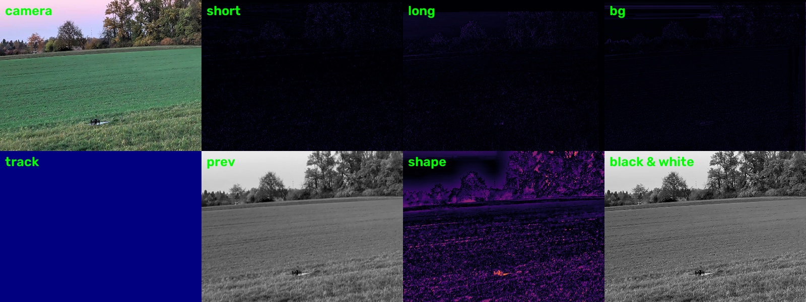

# Drone detection and tracking

Finds and tracks up to 2 drones in 1920x1080 video and writes one result file per video:
`frame,id,left,top,width,height,confidence` (frames start at 1, ids are 1 or 2 and stay the same when a drone leaves and comes back).
Target: real time (50 fps or more) on a Raspberry Pi with the AI HAT+ (Hailo-8, 26 TOPS).

## How it works

1. **Detector**: YOLO11n ([SkyGuardAI/drone-detection-yolov11](https://huggingface.co/SkyGuardAI/drone-detection-yolov11), MIT), being fine-tuned on our data.
2. **Tracker** (`tracker.py`): Kalman filter + two-threshold matching, at most 2 ids, re-identifies a returning drone by appearance (colour/brightness histogram, shape) and position. Quick re-acquisition: a drone lost less than 30 frames ago (for example after a sudden stop, when the prediction runs ahead) gets its own id back at once from a box with confidence 0.2 or more near where it was last seen and of similar size, instead of waiting 3 frames as a new track.
3. **Trajectory crops** (`stack.py`): where the tracker expects a drone, a zoomed crop is checked again, which finds small drones the full-frame pass misses.
4. **Extra input layers** (`layers.py`, for the multi-channel model B, not trained yet): short / long / background difference (camera-shake compensated), tracker map, previous frame, brightness shape.
5. **Motion detector** (`motion_live.py`): kept for the views; motion crops are off by default (they did not improve the score).
6. **Combined shape layer** (`consensus.py`, best setup): a pixel counts only where at least 2 of motion / background difference / brightness shape agree (1 is enough near where the tracker expects a drone), cleaned into at most 5 blobs per frame. Used as a second opinion, never to make boxes on its own:
   - **booster**: a faint detection (confidence 0.10 to 0.30) is trusted (raised to 0.65) when a white blob of similar size sits at the same spot;
   - **keeper**: a track is held through a detector gap (max 5 frames) only if a blob near the prediction moves in the same direction (within 45°) and at the same speed (0.5 to 1.5x) as the drone;
   - **verifier**: weak boxes with no layer support count less.
   Costs about 8 ms per frame on the CPU at 480 px.

## Scores on the 3 practice videos (IoU 0.5)

| Setup | MOTA | IDF1 | Precision | Recall | ID switches |
|---|---|---|---|---|---|
| SkyGuard + tracker | 0.843 | 0.916 | 0.983 | 0.858 | 0 |
| + trajectory crops | 0.855 | 0.916 | 0.980 | 0.873 | 1 |
| + boxes clipped to the frame (default, team evaluate.py) | 0.862 | 0.920 | 0.987 | 0.873 | 1 |
| + fine-tuned 1280 model on the trajectory crops only | 0.871 | 0.932 | 0.990 | 0.880 | 0 |
| + combined shape booster + keeper + verifier (`pipeline_boost.py`) | 0.878 | 0.936 | 0.991 | 0.886 | 0 |
| + quick re-acquisition after a sudden stop (tracker.py) | 0.880 | 0.937 | 0.986 | 0.893 | 0 |
| + trajectory crops enlarged 2x (`--crop-scale 2`) | 0.883 | 0.939 | 0.988 | 0.894 | 0 |
| + ID fixes (handover, inside, merge): same here, Anti-UAV ID switches 63 -> 35 | 0.883 | 0.939 | 0.988 | 0.894 | 0 |
| **+ boxes below 0.05 not output (tracker.py `MIN_SHOW`, best)** | **0.885** | **0.939** | **0.991** | **0.893** | **0** |

Best setup per video (MOTA): easy 0.964, medium 0.974, hard 0.818. The variants were chosen on these same 3 videos, so the gain on new videos may be a bit smaller.
Tried and worse: slowing the Kalman prediction on misses or matching near the last-seen spot (0.865-0.875), stacking past frames / de-blurring the crops (0.870-0.878), inverted-colour frames (0.79-0.83), squeezing crops along the motion direction (0.879-0.882), merging two full-frame models' boxes (0.84-0.855), feeding masked / dimmed / black-background frames to the AI (0.51-0.72), extra crops on every blob (0.857), dropping boxes with no blob (0.860),
learned confidence from all layers (0.859), ignoring non-moving boxes (0.869-0.873), point-motion layer (0.882),
constant-acceleration Kalman / stronger position weight (no gain), camera-motion compensation (`--cmc`: fewer wrong boxes
but one re-entry got the wrong number), higher output thresholds (0.1+: worse).

## Setup

    python -m venv .venv && source .venv/bin/activate
    pip install -r requirements.txt

Put the pretrained weights at `../pretrained/drone-detection-yolov11/best.pt` (download from the Hugging Face link above).
Data is not in this repo: `../test_sample_clean/<video>/video.mp4 (+ gt/gt.txt)`, `../hackathon_dataset`, Anti-UAV-RGBT.

## Run

Demo with switchable views:

    python demo.py ../test_sample_clean/test_6_hard_PXL_20261113_154422245_hard/video.mp4 --show
    python demo.py 0 --show            # live camera

Add `--clean` to hide the status text and answer boxes (nice for showing people).

Keys: 1 camera, 2 difference, 3 motion mask, 4 four-way view, 5 short diff, 6 long diff, 7 background diff,
8 tracker map, 9 previous frame, b brightness shape, 0 all layers, t trajectory, m motion crops, p trajectory crops,
o helper boxes, space pause, q quit.

Score all practice videos:

    python run_video.py --weights <best.pt> --videos ../test_sample_clean --out preds/x --imgsz 1280 --conf 0.01
    python pipeline.py --videos ../test_sample_clean --dets preds/x --out preds/x_trk --weights <best.pt> --no-motion
    python eval_track.py --gt ../test_sample_clean --pred preds/x_trk

Best setup (original SkyGuard on the full frame, fine-tuned 1280 model `ft_1280 epoch 1` on the crops; the fine-tuned weights are not in this repo):

    python run_video.py --weights ../pretrained/drone-detection-yolov11/best.pt --videos ../test_sample_clean --out preds/hf_skyguard --imgsz 1280 --conf 0.01 --keep drone
    python pipeline_boost.py --videos ../test_sample_clean --dets preds/hf_skyguard --out preds/boost --weights runs/ft_1280/weights/epoch0.pt \
      --no-motion --layer-width 480 --verify --keeper2 --agree-boost 0.1 --boost-to 0.65 --crop-scale 2
    python eval_track.py --gt ../test_sample_clean --pred preds/boost

Live demo of the best setup (keys: 1 camera, c white-shape view, 0 all layers, b booster on/off, k keeper on/off, t trails, space pause, q quit;
yellow box = booster confirmed a faint detection, dashed box = keeper held the track):

    python demo_boost.py                         # hard practice video
    python demo_boost.py --video path/to/any.mp4 # any video, --video 0 for the camera

`pi_run.py` is the real-time program for the Pi and runs the **full 0.883 setup** (same stages as `pipeline_boost.py`, shared in `boost.py`).
Check on the Mac (same code, PyTorch instead of Hailo): `python pi_run.py ../test_sample_clean --out results` and score `results/`.
With `--dets preds/hf_skyguard` it reuses the cached whole-frame detections and gives byte-identical files to `pipeline_boost.py`. `--simple` = old pipeline.

## Windows 10/11: complete guide

The detector, tracker, training scripts, evaluator, and live/video demos run natively in Windows PowerShell. Hailo `.hef` compilation is the exception; use WSL2 for that section below. These steps assume PowerShell, Python 3.11, and a project folder under your user directory.

### 1. Install Python and get the project

Install Python 3.11 from [python.org](https://www.python.org/downloads/) and select **Add Python to PATH** in the installer. Open a new PowerShell window and confirm `py -3.11 --version` prints Python 3.11. Then:

    $Root = "$env:USERPROFILE\drone detecting"
    New-Item -ItemType Directory -Force $Root | Out-Null
    Set-Location $Root
    git clone https://github.com/czarekkdev/drone_detection code
    Set-Location "$Root\code"

If Git is not installed, install Git for Windows first. Keep the repository in a normal Windows folder such as `C:\Users\<you>\drone detecting`; do not put the virtual environment inside OneDrive or a synced folder.

### 2. Create the environment and install packages

    py -3.11 -m venv .venv
    .\.venv\Scripts\Activate.ps1

If PowerShell blocks activation, run this once for your Windows account, close and reopen PowerShell, then activate again:

    Set-ExecutionPolicy -Scope CurrentUser RemoteSigned

For an NVIDIA graphics card, install the matching PyTorch CUDA build from [PyTorch's install selector](https://pytorch.org/get-started/locally/) first. For example, for CUDA 12.4:

    python -m pip install --upgrade pip
    pip install torch torchvision --index-url https://download.pytorch.org/whl/cu124
    pip install -r requirements.txt
    python -c "import torch; print('CUDA available:', torch.cuda.is_available())"

For CPU-only use, skip the CUDA install and install the project dependencies:

    python -m pip install --upgrade pip
    pip install -r requirements.txt
    python -c "import torch; print('CUDA available:', torch.cuda.is_available())"

`CUDA available: True` means PyTorch can use the NVIDIA GPU. If it prints `False`, the code still runs on the CPU, but video processing and the demo will be slower. AMD graphics cards are not supported by the CUDA setup.

### 3. Add the model weights and test videos

The Git repository does not include model weights or the practice videos. Arrange the folders like this (the video and ground-truth files are supplied separately):

    drone detecting\
      code\                         # cloned repository; run commands from here
        .venv\
        runs\ft_1280\weights\epoch0.pt   # fine-tuned crop model, if using best setup
      pretrained\drone-detection-yolov11\best.pt
      test_sample_clean\
        video_name\video.mp4
        video_name\gt\gt.txt

Create the parent folders as needed and copy the supplied files into these locations. If you have only the SkyGuard `best.pt` and no `epoch0.pt`, you can still run detection and the basic tracker; the full best setup below needs both weight files. Check that PowerShell can see the files before starting:

    Test-Path ..\pretrained\drone-detection-yolov11\best.pt
    Get-ChildItem ..\test_sample_clean -Recurse -Filter video.mp4
    Test-Path runs\ft_1280\weights\epoch0.pt

Each `Test-Path` needed for the command you plan to run should return `True`. Keep paths with spaces inside double quotes.

### 4. Run detection, tracking, and scoring

Run these from the repository folder with `.venv` active. Replace the video folder or weights path if yours differs. The angle brackets in documentation examples mean “replace this value”; do not type the brackets in PowerShell.

Run whole-frame detection first. This creates one detection file per input video under `preds\hf_skyguard`:

    python run_video.py --weights ..\pretrained\drone-detection-yolov11\best.pt --videos ..\test_sample_clean --out preds\hf_skyguard --imgsz 1280 --conf 0.01 --keep drone
    Get-ChildItem preds\hf_skyguard\*.txt

Then run the full shape-assisted tracker (requires the fine-tuned crop model), followed by the organizer's evaluator:

    python pipeline_boost.py --videos ..\test_sample_clean --dets preds\hf_skyguard --out preds\best --weights runs\ft_1280\weights\epoch0.pt --no-motion --layer-width 480 --verify --keeper2 --agree-boost 0.1 --boost-to 0.65 --crop-scale 2
    python evaluation.py --gt_dir ..\test_sample_clean --pred_dir preds\best

Copy the organizer-supplied `evaluation.py` into the repository folder before running the last command. It is separate from this repo. Check that `preds\hf_skyguard` and `preds\best` contain non-empty `.txt` files for the videos. If the evaluator reports missing files, first compare the video folder names under `test_sample_clean` with the prediction filenames; if it reports empty files, check that detection created boxes before running the tracker.

If you do not have the crop model or organizer evaluator, run the basic pipeline and included evaluator instead:

    python pipeline.py --videos ..\test_sample_clean --dets preds\hf_skyguard --out preds\basic --weights ..\pretrained\drone-detection-yolov11\best.pt --no-motion
    python eval_track.py --gt ..\test_sample_clean --pred preds\basic

You can also use the evaluator supplied by the team with `--pred_dir preds\basic` if its expected prediction format matches the generated files.

### 5. Play a video or use a camera

    python demo_boost.py --video "..\test_sample_clean\test_6_hard_PXL_20261113_154422245_hard\video.mp4"
    python demo_boost.py --video 0

The live camera is usually device `0`; try `1` if you have multiple cameras. Press `q` to quit. In `demo_boost.py`, press `f` to toggle the optional camera-motion-subtracted optical-flow view; it adds processing while enabled and does not change detections. Press `o` to toggle the combined-shape view.

### Common Windows issues

- **`python` is not recognized:** reinstall Python 3.11 with **Add Python to PATH**, or use `py -3.11` to create the environment. After activation, `python --version` should show 3.11.
- **Activation is disabled:** use the one-time `Set-ExecutionPolicy -Scope CurrentUser RemoteSigned` command above, or run commands with `.\.venv\Scripts\python.exe` without activating.
- **`FileNotFoundError`:** run `Get-Location` and `Test-Path <path>`; relative paths are resolved from the current folder. The commands in this guide expect the current folder to be `drone detecting\code`.
- **CUDA is unavailable:** verify the GPU is NVIDIA and reinstall the PyTorch build selected for your installed driver. CPU mode remains available.
- **OpenCV cannot open a video/camera:** try a different camera number, close other apps using the camera, and confirm the video plays in a media player.
- **Out of memory:** close GPU-heavy apps; for training, lower the batch size (for example `--batch 8`).
- **Hailo compile:** native Windows is not supported for the compiler; use WSL2 Ubuntu 22.04 as described in the next section.

Training also runs from the activated environment, for example `python finetune.py ...`. If training cannot find images, set the dataset `path:` in the YAML to an absolute Windows path using forward slashes, such as `C:/Users/name/drone detecting/code/drone_data`.

## Raspberry Pi 5 + AI HAT+ (Hailo-8)

`pi_run.py` runs the **full 0.883 setup** in real time: whole-frame SkyGuard + 2x-enlarged trajectory crops with the
fine-tuned crop model + shape layer (verify, booster, keeper) + tracker. On the Pi both networks run on the Hailo chip,
so you need **two `.hef` files**: `skyguard.hef` (whole frame) and `crop_640.hef` (crop model).

Status: **not tested on a real Pi yet** and 50 fps not measured yet. Expect small fixes on the first run.

Overview (3 machines: Mac, a Linux PC for compiling, the Pi):

| Step | Where | Result |
|---|---|---|
| 1. Export both models to ONNX | Mac (Python 3.12) | `best.onnx`, `epoch0.onnx` |
| 2. Calibration images | Mac | `calib/` |
| 3. Compile | x86 Linux PC: Ubuntu 22.04, or Windows + WSL2 Ubuntu 22.04 (not the Mac, not the Pi) | `skyguard.hef`, `crop_640.hef` |
| 4. Run + score | Raspberry Pi | fps per stage + MOTA |

You need: the SkyGuard model (`pretrained/drone-detection-yolov11/best.pt`), the crop model (release v0.883 asset,
`ft_1280_ep1_crop.pt`, here called `runs/ft_1280/weights/epoch0.pt`), `test_sample_clean/`, and the team's `evaluation.py`.

### On Windows: do steps 1-3 inside WSL2

On Windows everything up to the .hef happens in one place, **WSL2 with Ubuntu 22.04** (it counts as the x86 Linux PC):

    wsl --install -d Ubuntu-22.04        # in PowerShell as admin, then restart and open "Ubuntu 22.04"

Inside Ubuntu, your Windows drive is `/mnt/c`, so a folder `C:\Users\<you>\drone detecting` is
`"/mnt/c/Users/<you>/drone detecting"`. Then:

    sudo apt update && sudo apt install -y python3.10 python3.10-venv python3.10-dev graphviz graphviz-dev git libgl1
    git clone https://github.com/czarekkdev/drone_detection && cd drone_detection
    D="/mnt/c/Users/<you>/drone detecting"         # folder with pretrained/, the crop model, test_sample_clean/

    # step 1 (export) + step 2 (calibration) in their own environment
    python3.10 -m venv ~/export && source ~/export/bin/activate
    pip install ultralytics onnx onnxslim onnxruntime
    python -c "from ultralytics import YOLO; YOLO('$D/pretrained/drone-detection-yolov11/best.pt').export(format='onnx', imgsz=640, opset=11)"
    python -c "from ultralytics import YOLO; YOLO('$D/code/runs/ft_1280/weights/epoch0.pt').export(format='onnx', imgsz=640, opset=11)"
    python make_calib.py --videos "$D/test_sample_clean" --out calib --n 600
    cp "$D/pretrained/drone-detection-yolov11/best.onnx" "$D/code/runs/ft_1280/weights/epoch0.onnx" .
    deactivate

    # step 3 (compile): put the Hailo .whl files you downloaded (Windows Downloads = /mnt/c/Users/<you>/Downloads) here
    python3.10 -m venv ~/hailo && source ~/hailo/bin/activate
    pip install /mnt/c/Users/<you>/Downloads/hailo_dataflow_compiler-*.whl /mnt/c/Users/<you>/Downloads/hailo_model_zoo-*.whl
    hailomz compile yolov11n --ckpt best.onnx   --hw-arch hailo8 --calib-path calib/ --classes 1 && mv yolov11n.hef skyguard.hef
    hailomz compile yolov11n --ckpt epoch0.onnx --hw-arch hailo8 --calib-path calib/ --classes 1 && mv yolov11n.hef crop_640.hef
    cp skyguard.hef crop_640.hef "$D/"             # now they are in the Windows folder too

Version matching (below, step 3) applies the same way. Then copy the two `.hef` files, `test_sample_clean/` and `evaluation.py`
to the Pi (USB stick, or `scp` from PowerShell) and continue with step 4. The Mac and Windows steps make identical files.

### 1. Export to ONNX (Mac)

The ONNX tools (onnxruntime) have no build for Python 3.15 yet, so use a separate **Python 3.12** environment just for this:

    brew install python@3.12
    python3.12 -m venv ~/onnx312
    ~/onnx312/bin/pip install ultralytics onnx onnxslim onnxruntime
    D="/Users/<you>/Downloads/drone detecting"        # folder with pretrained/, code/runs/, test_sample_clean/
    ~/onnx312/bin/python -c "from ultralytics import YOLO; YOLO('$D/pretrained/drone-detection-yolov11/best.pt').export(format='onnx', imgsz=640, opset=11)"
    ~/onnx312/bin/python -c "from ultralytics import YOLO; YOLO('$D/code/runs/ft_1280/weights/epoch0.pt').export(format='onnx', imgsz=640, opset=11)"

This writes `best.onnx` next to `best.pt` and `epoch0.onnx` next to `epoch0.pt`.
Both are exported at **640**: the crop model always gets 640x640 (320 px crops enlarged 2x). For the whole-frame model 640
is the safe start; 1280 is about 4x the work and unlikely to reach 50 fps on the Hailo-8, 960 is the middle option.

### 2. Calibration images (Mac, in this repo folder)

The compiler converts the models to 8-bit and needs real-looking frames to do that:

    python make_calib.py --videos "$D/test_sample_clean" --out calib --n 600

(`make_calib.py` missing in your folder? `git fetch origin && git checkout origin/main -- make_calib.py`.)
Copy `best.onnx`, `epoch0.onnx` and the `calib/` folder to the Linux PC.

### 3. Compile (x86 Linux PC or WSL2)

**Match the versions first.** On the Pi run `hailortcli --version`. The compiler must come from the **same Hailo software
release**, otherwise the Pi refuses the .hef. For Hailo-8 that means **Dataflow Compiler 3.x + Model Zoo 2.x**
(DFC 4.x / Model Zoo 5.x are for Hailo-10).

Download from the Hailo Developer Zone (free account) -> Software Downloads -> Hailo-8 / AI Software Suite, for that release:
the **Dataflow Compiler** wheel (`hailo_dataflow_compiler-<ver>-py3-none-linux_x86_64.whl`) and the **Model Zoo**
(`hailo_model_zoo-<ver>-py3-none-any.whl`, or `git clone https://github.com/hailo-ai/hailo_model_zoo` at the matching tag).

    sudo apt install python3.10 python3.10-venv python3.10-dev graphviz graphviz-dev
    python3.10 -m venv hailo && source hailo/bin/activate
    pip install hailo_dataflow_compiler-*.whl
    pip install hailo_model_zoo-*.whl          # or: cd hailo_model_zoo && pip install -e .
    hailo --version && hailomz --help          # both should work

    hailomz compile yolov11n --ckpt best.onnx   --hw-arch hailo8 --calib-path calib/ --classes 1 && mv yolov11n.hef skyguard.hef
    hailomz compile yolov11n --ckpt epoch0.onnx --hw-arch hailo8 --calib-path calib/ --classes 1 && mv yolov11n.hef crop_640.hef

- `yolov11n` is the Model Zoo's YOLO11n recipe, which puts the **NMS post-process on the chip** (pi_run.py expects that).
- `--classes 1`: both models have one class (drone). `--hw-arch hailo8`: the AI HAT+ 26 TOPS (13 TOPS would be `hailo8l`).
- Add `--performance` for a faster .hef (compiling takes 30-60+ min); leave it out for a quick first test.
- Complaints about ONNX end nodes: re-export with `simplify=True`, or pass the `--start-node-names` / `--end-node-names`
  printed in the error.
- Big accuracy drop after 8-bit conversion: more and more varied calibration images (`--n 1000`).
- Whole frame at 960 / 1280: copy the Model Zoo's `yolov11n.yaml`, change the input shape, `hailomz compile --yaml my.yaml ...`.

#### Optional 960px whole-frame model (Pi only)

Keep the existing HEF and Mac setting unchanged. A 960px HEF is a separate Pi model selected explicitly with `--hef`; Hailo uses the input size compiled into the HEF, so `--imgsz` does not resize it. The 960px Mac test was faster than 1280 but lost accuracy, so score this Pi build before adopting it.

Export SkyGuard at 960, copy the Model Zoo's `yolov11n.yaml` to `yolov11n_960.yaml`, set its `preprocessing.input_shape` to `[960, 960, 3]`, then compile it on the same x86 Linux/WSL2 environment and Hailo software release as the existing HEFs:

    python -c "from ultralytics import YOLO; YOLO('$D/pretrained/drone-detection-yolov11/best.pt').export(format='onnx', imgsz=960, opset=11)"
    cp best.onnx best_960.onnx
    hailomz compile --ckpt best_960.onnx --yaml yolov11n_960.yaml --hw-arch hailo8 --calib-path calib/ --classes 1
    mv yolov11n.hef skyguard_960.hef

Copy `skyguard_960.hef` to the Pi alongside the unchanged `crop_640.hef`, then run the same videos with:

    python pi_run.py test_sample_clean --backend hailo --hef skyguard_960.hef --crop-hef crop_640.hef --out results_960
    python evaluation.py --gt_dir test_sample_clean --pred_dir results_960

This changes only the Pi run that names `skyguard_960.hef`; the Mac/PyTorch run and the existing HEF remain at their current sizes. Compare the printed Pi fps and evaluation score with the existing HEF before choosing which one to use.

### 4. Set up the Pi

Raspberry Pi OS 64-bit, AI HAT+ attached:

    sudo apt update && sudo apt install hailo-all && sudo reboot   # driver + HailoRT + Python bindings
    hailortcli fw-control identify                                 # should list the Hailo-8
    git clone https://github.com/czarekkdev/drone_detection && cd drone_detection
    python -m venv --system-site-packages .venv && source .venv/bin/activate   # system site = hailo_platform
    pip install opencv-python numpy scipy motmetrics pandas

Copy into the `drone_detection` folder on the Pi (USB stick or `scp`): `skyguard.hef`, `crop_640.hef`,
`test_sample_clean/` and `evaluation.py`. Check the files:

    hailortcli parse-hef skyguard.hef      # input 640x640x3, output an NMS layer
    hailortcli run skyguard.hef            # raw chip fps, without video decode or tracker

### 5. Run and score on the Pi

    H="--backend hailo --hef skyguard.hef --crop-hef crop_640.hef"
    python pi_run.py test_sample_clean $H --out results                   # all practice videos
    python evaluation.py --gt_dir test_sample_clean --pred_dir results    # the score (MOTA, IDF1, F1, ...)

    python pi_run.py video.mp4 $H                  # one video
    python pi_run.py 0 $H                          # live camera
    python pi_run.py video.mp4 $H --realtime       # feed frames at the video's own fps, like a camera

Three threads overlap: read, whole-frame model, finish (crops + shape layer + booster/keeper + tracker). Per video it prints
end-to-end fps and ms per stage; the slowest thread is the fps limit (50 fps = 20 ms per frame).
Results go to `results/<video folder name>.txt`, the competition format.

What to expect and what to try:
- The score will be somewhat below 0.883: the whole frame runs at 640 instead of 1280, and both models in 8-bit.
- Finish thread too slow: the shape layer is CPU work (about 8 ms/frame at 480 px on an M5 Mac, likely 2-3x on the Pi 5);
  try `--layer-width 320` and re-check the score.
- Model thread too slow: compile with `--performance`; if it is fast with room to spare, try the whole frame at 960.
- `--simple` runs the old pipeline (no shape layer, no fine-tuned crops) with only `--hef`, for comparison.

## Training

    python prep_data.py --src ../hackathon_dataset --dst drone_data          # single class, hard links
    python convert_antiuav.py --help                                          # Anti-UAV-RGBT videos -> YOLO frames
    python finetune.py --weights ../pretrained/drone-detection-yolov11/best.pt --data drone_hack.yaml --epochs 10 --imgsz 640
    python finetune.py --weights ../pretrained/drone-detection-yolov11/best.pt --data drone_ft.yaml   # hackathon + Anti-UAV

`mlayer.py` / `train.py` are an earlier colour-vs-grayscale experiment, kept for reference.

## Views

